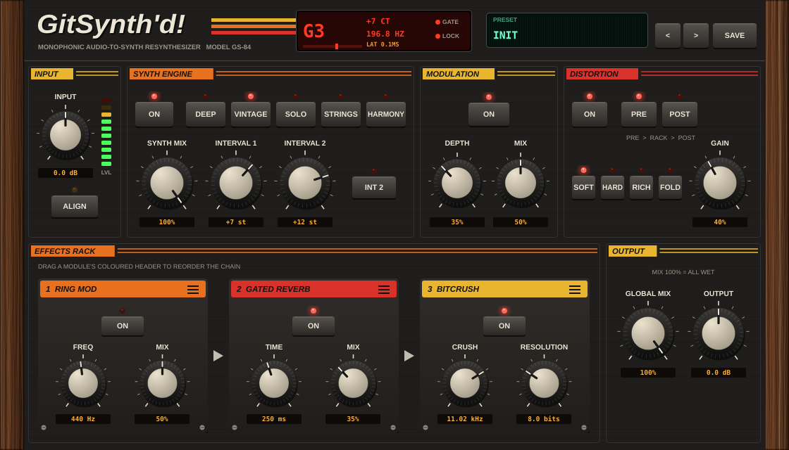

# GitSynth'd!

A real-time, monophonic **audio-to-synth processor and multi-effects rack** (VST3, AU, AAX, plus a Standalone app). Play a guitar, bass, voice or any single-note source into it and a synth voice follows your pitch, bends, slides and vibrato. It is a pure audio processor: audio in, audio out, no MIDI at all.



## Signal flow

```
In -> Input Gain -+-> pitch tracker -> Synth Engine + Mod -> Synth Mix -> Distortion (Pre)
                  |                                     ^                  |
                  |                raw input -----------+                  v
                  |                         [ Bitcrush / Ring Mod / Gated Reverb ]  (any order)
                  |                                                        |
                  +----------------------- dry bus ----> Global Mix <- Distortion (Post)
                                                              |
                                                         Output Gain -> Out
```

## Controls

| Section | Control | What it does |
|---|---|---|
| **Input** | Input (-24 to +24 dB) | Trims the level feeding both the tracker and the dry bus. The synth's own level doesn't follow it, so it mainly sets **tracking sensitivity** (the gate opens around -50 dBFS after this gain). The LED column shows the level going in. |
| | ALIGN | Off (default): **zero latency**. On: adds 12 ms of lookahead so the dry signal lines up with the synth. See *Latency* below. |
| **Synth Engine** | ON | Off turns GitSynth'd! into a plain effects rack for your dry signal. |
| | DEEP / VINTAGE / SOLO / STRINGS / HARMONY | The five voices. **Deep**: sub-octave, low-passed bass with a rounded attack. **Vintage**: warm saw + square with soft top end. **Solo**: bright, cutting lead with slow pulse-width movement. **Strings**: slow-attack, detuned ensemble. **Harmony**: your note plus Interval 1, and Interval 2 when its button is lit. |
| | Synth Mix | Blends your raw input against the synth before the effects. |
| | Interval 1 / 2 (-24 to +24 st) | Harmony voices. Interval 1 is always on in Harmony mode; INT 2 toggles the second. |
| **Modulation** | ON, Depth, Mix | Two micro-pitch-shifted copies of the synth (one flat, one sharp, up to 25 cents) panned left and right. Only affects the synth, and it sums cleanly to mono. |
| **Distortion** | ON, PRE, POST | PRE sits before the rack, POST after it, or use both. They share Gain and Mode. One of them always stays lit while the module is on. |
| | SOFT / HARD / RICH / FOLD | Tube-style asymmetric saturation, hard-clip fuzz, even-harmonic warmth, and a two-stage wavefolder for metallic tones. Runs 2x oversampled. |
| | Gain | Drive amount. Output level is roughly compensated. |
| **Effects Rack** | drag the coloured headers | Drag a module's header onto another module to reorder the chain. The order is saved with presets and is automatable. |
| Bitcrush | Crush, Resolution | Sample-and-hold down to 441 Hz (top of the range is 44.1 kHz even in 48/96 kHz sessions), and 1 to 24 bit mid-tread quantising. |
| Ring Mod | Freq, Mix | Multiplies with a 20 Hz to 5 kHz sine carrier. |
| Gated Reverb | Time, Mix | 80s non-linear reverb: dense, stereo-asymmetric reflections that last exactly Time ms then stop dead (0 ms gives a short burst). New notes never cut off older tails. |
| **Output** | Global Mix, Output | Global Mix crossfades the dry bus against everything after the input stage. Output is the final trim. |

Double-click any knob to reset it. Drag knobs up/down.

## Latency

GitSynth'd! was designed to be as low-latency as possible:

* **Reported plugin latency is 6 samples (about 0.1 ms)**. That is only the distortion oversampling, and it stays constant whether distortion is on or off so your DAW never has to re-adjust.
* The pitch tracker has **no lookahead**. It recognises a new note after about two cycles of it: roughly 14 ms for low E (82 Hz), 6 ms for A3, 2 ms for C6. That is about as fast as any pitch detector can physically be.
* Pitch accuracy in testing: under 1 cent below 330 Hz and under 2 cents average up to C6.
* **ALIGN** switches to the original 12 ms lookahead design (reported to the host so it is compensated). Use it when you blend a lot of dry signal and want it perfectly lined up with the synth. Leave it off for live playing.
* The rest of your total latency is your audio interface's buffer size. 64 or 128 samples is ideal for playing live.

## Presets

Use **<** and **>** to step through presets and **SAVE** to store the current sound. Presets are `.preset` files in:

* Windows: `Documents\GitSynthd\Presets`
* macOS: `~/Documents/GitSynthd/Presets`

Eight factory presets are created the first time. You can copy `.preset` files between computers. Your DAW also saves the full state with your project.

---

## Building with GitHub (no compiler needed)

This works just like the earlier plugins. GitHub builds the plugin on its own computers and gives you a download.

### 1. Create the repository

1. Sign in at **github.com**.
2. Click the **+** in the top-right corner, then **New repository**.
3. Name it `GitSynthd`. GitHub doesn't allow the apostrophe or `!` in repository names.
4. Choose **Public** or **Private**. Leave "Add a README" **unchecked**, then click **Create repository**.

### 2. Upload the files

1. On the new page, click **uploading an existing file**.
2. Open the extracted `GitSynthd` folder (not the zip). Select `CMakeLists.txt`, `README.md`, `screenshot.png`, and the `Source` and `Tests` folders, and drag them into the browser window.
3. Wait until every file is listed. `Source` contains `PluginProcessor.cpp/.h`, `PluginEditor.cpp/.h`, `Parameters.h`, `PresetManager.h` and a `DSP` folder with 7 files.
4. Click **Commit changes**.

### 3. Add the build file

The `.github` folder is hidden in File Explorer, so it's easiest to create the build file by hand:

1. Click **Add file > Create new file**.
2. Type the name exactly: `.github/workflows/build.yml` (each `/` makes a folder; don't forget the dot at the start).
3. Paste this in. The spaces at the start of lines matter, so use the copy button:

```yaml
name: Build GitSynth'd!
on: [push, workflow_dispatch]
jobs:
  windows:
    runs-on: windows-latest
    steps:
      - uses: actions/checkout@v5
      - run: cmake -B build -G "Visual Studio 17 2022" -A x64
      - run: cmake --build build --config Release --target GitSynthd_VST3 GitSynthd_Standalone
      - uses: actions/upload-artifact@v6
        with:
          name: GitSynthd-VST3-Windows
          path: build/GitSynthd_artefacts/Release/VST3/
      - uses: actions/upload-artifact@v6
        with:
          name: GitSynthd-Standalone-Windows
          path: build/GitSynthd_artefacts/Release/Standalone/

  mac:
    runs-on: macos-latest
    steps:
      - uses: actions/checkout@v5
      - run: cmake -B build -G Xcode
      - run: cmake --build build --config Release --target GitSynthd_VST3 GitSynthd_AU
      - uses: actions/upload-artifact@v6
        with:
          name: GitSynthd-Mac-VST3-AU
          path: |
            build/GitSynthd_artefacts/Release/VST3/
            build/GitSynthd_artefacts/Release/AU/
```

4. Click **Commit changes...**, then **Commit changes** in the popup.

### 4. Download the plugin

1. Open the **Actions** tab. If GitHub asks you to enable workflows, click the button.
2. Wait for the run to finish (about 10 to 15 minutes). A yellow dot means building, a green check means done.
3. Click the finished run, scroll to **Artifacts** and download **GitSynthd-VST3-Windows**. (Mac users: **GitSynthd-Mac-VST3-AU**.)

### 5. Install

**Windows:** extract the zip and copy the `GitSynthd.vst3` folder into `C:\Program Files\Common Files\VST3\`. Rescan plugins in your DAW. It shows up as **GitSynth'd!** from **Will**.

**Mac:** copy `GitSynthd.vst3` into `~/Library/Audio/Plug-Ins/VST3/` and `GitSynthd.component` into `~/Library/Audio/Plug-Ins/Components/`. Because the build isn't signed, run this once in Terminal before opening your DAW:
`xattr -dr com.apple.quarantine ~/Library/Audio/Plug-Ins/VST3/GitSynthd.vst3 ~/Library/Audio/Plug-Ins/Components/GitSynthd.component`

### Updating later

Upload the changed files with **Add file > Upload files** (drag the `Source` folder again to replace it), click **Commit changes**, and a new build starts automatically.

### If the build fails

Open the run, click the job with the red X, and expand the step with the red X. Send a screenshot of the error text.

---

## AAX (Pro Tools)

AAX needs Avid's free AAX SDK, which can't be shared publicly, so it isn't in the GitHub build.

1. Join the Avid developer program and download the AAX SDK.
2. Build it yourself: `cmake -B build -DAAX_SDK_PATH=C:/path/to/aax-sdk` then `cmake --build build --config Release --target GitSynthd_AAX`.
3. Unsigned AAX plugins only load in **Pro Tools Developer**. Regular Pro Tools needs the plugin signed with PACE (Avid provides the tools once you're accepted).

## Building on your own computer

You need CMake 3.22+ and a compiler (Visual Studio 2022 with "Desktop development with C++" on Windows, Xcode on Mac).

```
cmake -B build
cmake --build build --config Release --target GitSynthd_VST3
```

JUCE 9.0.5 is downloaded automatically the first time.

### Offline tests (optional)

```
cmake -B build -DGITSYNTHD_TESTS=ON
cmake --build build --config Release --target GitSynthdTests
```

Running `GitSynthdTests` checks tracker accuracy and lock time from E2 to C6 at 44.1/48/96 kHz, vibrato following, reported vs measured latency, and stress-tests every engine, distortion mode, rack order, sample rate and block size for runaway levels or NaNs. Pass a file name to also save a picture of the interface.

## Project layout

```
CMakeLists.txt
Source/
  PluginProcessor.h/.cpp   signal flow, latency, state
  PluginEditor.h/.cpp      80s-style interface, drag-and-drop rack
  Parameters.h             every parameter (and the 6 rack orders)
  PresetManager.h          .preset files + factory presets
  DSP/Common.h             filters, delay lines, oscillators helpers
  DSP/PitchTracker.h       zero-lookahead YIN-style tracker + gate
  DSP/SynthEngine.h        the five synth voices
  DSP/SynthModulation.h    micro-pitch-shift stereo spread
  DSP/Distortion.h         4 waveshapers, 2x oversampled
  DSP/RackModules.h        Bitcrush, Ring Mod, Gated Reverb
Tests/DspTests.cpp
.github/workflows/build.yml
```
